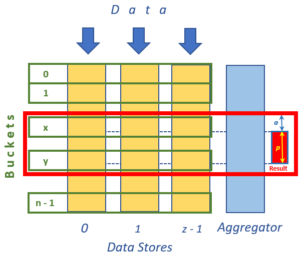

# Sorted Page from Distributed Unsorted Data Sets

**Author:** Igor Ladnik  
**Email:** ladnik@hotmail.com

Algorithm and C# code to create a sorted page from several large, frequently changing, unsorted data sets.

## Repository and build instructions

The original C# source files and project files are preserved unchanged from the Dropbox archive `for article - Sorted Page from Unsorted Distributed Data.zip`. The full article follows below, converted from HTML; its [original HTML](docs/Sorted%20Page%20from%20Unsorted%20Distributed%20Data.html) and diagram are also included.

- `MergeForPage.sln`: Visual Studio solution.
- `AggregatedSortedPage/`: generic library containing the bucket containers and page aggregator.
- `TestApp/`: console demonstration, including `t8.shakespeare.txt` from the original archive.
- `docs/`: original article and diagram.

Open `MergeForPage.sln` in Visual Studio with .NET Framework 4.5 targeting support. The projects target .NET Framework 4.5; the source uses C# 6 string interpolation, so a C# 6 capable compiler (Visual Studio 2015 or later) is needed. Set `TestApp` as the startup project, build, and run. The sample reads `t8.shakespeare.txt` from the working directory, or two directories above it (the original Debug/Release output layout).

The demonstration uses three in-process data stores and requests 25 items at offset 15000, then repeats after insertion and removal. Remote-call proxies and distributed snapshot coordination are outside this sample.

**Original article license declaration:** CPOL. No replacement license has been applied.

## Original article

Original title: **Sorted Page from Unsorted Distributed Data**.

## Problem Statement

Recently in my practical work I came across the following problem. 

There are several Data Stores located in different worker machines, each of which has unsorted set of objects of the same type. The sets are large and volatile meaning that items often are inserted to / removed from the sets (we control insertion / removal procedure). The system should response to the following query: <i> present in another Aggregator machine a page of <b><i>p</i></b> objects of merged sorted list of objects from all sets with some <b><i>offset</i></b> from the beginning of the combined sorted list. </i> 

Such problem arises, for example, when user wants to see (either by pages or in scrollable table) sorted merged list of frequently changed objects scattered over different computers. 

Straightforward solution to the problem is to 

- copy and merge sets from all Data Stores to Aggregator machine, 

- sort the combined set to a global sorted list, and 

- take <b><i>p</i></b> objects starting with <b><i>offset</i></b> object. 

This naive solution does not suit to our case with large and frequently updated Data Stores due to massive objects transfer from Data Stores to Aggregator on each query. A better solution should reduce number of transferred objects as much as possible. 

Although the above problem looks fairly standard, I failed to find its documented solution in Internet, let alone its code implementation. 

## Solution

Proposed solution is following. Objects in all Data Stores are categorized according to some simple rules to certain <i>buckets</i>. Rules to place an object to a bucket are uniform for all Data Stores. Categorizing procedure should be relatively simple and inexpensive. For example, if our objects are words then division to buckets may be done by the first or by two leading letters of the word. To solve our problem we 

- temporary freeze all Data Stores,

-  Aggregator collects length of each bucket in all Data Stores,

-  Aggregator calculates total number of objects in each bucket in all Data Storage, and 

<b>S</b><sub><i>k</i></sub> - number of all objects in the first <i>k</i> buckets (numbers between <i>0</i> and <i>k - 1</i>) in all Data Stores. 

-  find bucket numbers <b>x</b> and <b>y</b> satisfying the following conditions:

<b>S</b><sub><i>x</i></sub> ≤ <b><i>offset</i></b> & <b>S</b><sub><i>x+1</i></sub> &gt; <b><i>offset</i></b> (1) 

<b>S</b><sub><i>y</i></sub> ≤ <b><i>offset + p</i></b> & <b>S</b><sub><i>y+1</i></sub> &gt; <b><i>offset + p</i></b> (2) 

-  load content of buckets with numbers beween <b>x</b> and <b>y</b> inclusively from all Data Stores to Aggregator (at this point Data Stores freeze may be lifted) 

-  sort objects of each bucket from all Data Stores separately and 

-  compose final sorted list of all buckets and take a result page of <b><i>p</i></b> objects from the list starting from object number <b><i>a</i></b> where 

<b><i>a</i></b> = <b><i>offset</i></b> - <b>S</b><sub><i>x</i></sub> (3) 

The following figure illustrates the above algorithm. 



In the figure data are inserted to / remove from <i>z</i> Data Stores <i>0, 1, ..., z - 1</i>. Objects in the Data Stores categorized in <i>n</i> buckets numbered <i>0, 1, ..., n - 1</i>. Red frame encompassing buckets between <b>x</b> and <b>y</b> defined by conditions (1) and (2) depicts content transferred to Aggregator. Reg rectangle Result shows final result page of <b><i>p</i></b> objects starting at object <b><i>a</i></b> of merged sorted list in Aggregator. Number <b><i>a</i></b> is calculated by (3). 

## Sotfware Implementation

The algorithm is implemented in plain C# in assembly (dll) <i>AggregatedSortedPage</i>. The assembly contains interface IDataStoreBucketsContainer&lt;T&gt;, where T is a type of the objects to be sorted, and classes DataStoreBucketsContainer&lt;T&gt; (implementing the interface), Aggregator and Query. Interface IDataStoreBucketsContainer&lt;T&gt; provides methods to get buckets length GetBucketsLength() and content GetBucketsContent(). Class DataStoreBucketsContainer&lt;T&gt; implementing interface IDataStoreBucketsContainer&lt;T&gt;, dealls with real Data Store and contains buckets in its dictionary. It is also able to add / remove objects to / from its buckets. In order to get buckets length and content Aggregator has to call methods of IDataStoreBucketsContainer&lt;T&gt; interface. If Aggregator and DataStoreBucketsContainer&lt;T&gt; are located in the same process (like in our rather illustrative and not quite realistic sample) then Aggregator calls methods of DataStoreBucketsContainer&lt;T&gt; directly. But in reality Aggregator queries Data Stores from different processes. For that purpose appropriate proxy implementing interface IDataStoreBucketsContainer&lt;T&gt; is required (not shown in this code sample). The proxy is capable to call methods of remote DataStoreBucketsContainer&lt;T&gt; object from the Aggregator's process. Appropriate infrastructure should be provided in order to support these inter-process calls. 

Aggregator is a stateless static class. Its the only public method GetPage&lt;T&gt;() takes as parameter instance of IDataStoreBucketsContainer&lt;T&gt; (either proxy or real DataStoreBucketsContainer&lt;T&gt;), object implementing System.Collections.Generic.IComparer&lt;T&gt; interface for comparison of T type objects in order to sort them, and query object of Query type. 

Described above software does not impose any requirements on sortable objects of type T. Rules for distibution them to buckets, objects comparison and queries are separated from both the objects' type and algorithm implementation. To serve query on each index (criterion) two outer entities should be provided, namely, 

-  method for categorizing objects by buckets (delegate of type System.Func&lt;T, int&gt; as a parameter in constructor of DataStoreBucketsContainer&lt;T&gt;), and 

-  method for comparison of two objects (as implementation of System.Collections.Generic.IComparer&lt;T&gt; interface as a parameter for static Aggregator.GetPage&lt;T&gt;() method). 

These metdods are used in different places since in real life classes DataStoreBucketsContainer&lt;T&gt; and Aggregator run in different processes. 

Class DataStoreBucketsContainer&lt;T&gt; provides method GetInfo() for its buckets inspection. It returns tuple containing list of length of each bucket in the Data Store, average number of objects and ratio of buckets length to the average. Although this method is not used for directly for the problem solution, it may be useful to optimize bucket distribution rules. 

## Code Sample

In order to test assembly <i>AggregatedSortedPage</i> console application <i>TestApp</i> is used. Class Item represents the sorting objects type. It is sorted by alphabetic order of its public string property Word. Class ComparerItem contains both method to categorized Word property to buckets and to comparer two words implementing interface System.Collections.Generic.IComparer&lt;T&gt;. The buckets roughly follow the first letter of a word although some letters are combined to a single bucket where as some others are split to two buckets (in the latter case two leading letters are analyzed). 

Text file <i>t8.shakespeare.txt</i> containing all writings of William Shakespeare downloaded from [here](https://ocw.mit.edu/ans7870/6/6.006/s08/lecturenotes/files/t8.shakespeare.txt) is used as words source with auxiliary symbols like commas, apostrophs, etc. removed. Only distinct words are taken for the test (no words duplications). Empty strings are also taken out of the list. After these modifications there are <i>29541</i> words remaining in the list. File should be downloaded and placed either in folder with <i>TestApp.exe</i> or in folder of <i>TestApp.csproj</i>. The file name in hardcoded in <i>Program.cs</i> (of course, any other large enough text file may be used for testing - just name should be changed in the code). To facilitate subsequent check for correctness of queries execution all items in the list were alphabetically sorted and their serial numbers and Data Stores were placed in their appropriate properties used for testing purposes and described below. 

Class Item has two auxiliary properties used only for testing purposes. Property DataStore indicates Data Store containing this item, and property Num presents serial number of the item in full sorted list (i.e. list of all distinct words in the file sorted in alphabetic order). These two properties allow us effectively check result of our query execution. Please note that in real life the properties are of no use. 

For test we equally devide all our words to three Data Stores and execute query with <b><i>offset</i></b> = <i>15000</i> and <b><i>p</i></b> = <i>25</i>. This query is executed first for the set of words without change and then with a word adding to and removal from one of the Data Stores. Results of query on unchanged words set is presented below (as you can see some of words spell incorrect since symbols like apostrophs were removed): 

```text

Data Stores Lists Aggregator

start: 15000, num: 25

COMBINED SERIAL NUM.   NUM. IN PAGE  DATA STORE   WORD
15000                  0            2        loaf
15001                  1            0        loam
15002                  2            1        loan
15003                  3            1        loath
15004                  4            2        loathd
15005                  5            0        loathe
15006                  6            1        loathed
15007                  7            0        loather
15008                  8            0        loathes
15009                  9            1        loathing
15010                  10            0        loathly
15011                  11            2        loathness
15012                  12            2        loathsome
15013                  13            1        loathsomeness
15014                  14            2        loathsomest
15015                  15            1        loaves
15016                  16            0        lob
15017                  17            2        lobbies
15018                  18            1        lobby
15019                  19            1        local
15020                  20            0        lochaber
15021                  21            0        lock
15022                  22            1        lockd
15023                  23            2        locked
15024                  24            0        locking

```

We got <i>COMBINED SERIAL NUM.</i> and <i>DATA STORE</i> columns contents due to auxiliary properties of Item class. From above result we see that our query was fulfilled correctly and words come from all Data Stores. 

## Discussion

To increase effectiveness of the algorithm each bucket should contain relatively small number of objects (of course, number of buckets should be reasonable). This allows system to transfer less objects from Data Stores to Aggregator and sort less objects by Aggregator for final combined list. In the other hand, rules for objects distribution to buckets should be simple and inexpensive to reduce calculation and locking time in case of objects massive adding. 

## Thanks

I'd like to thank Shlomi Levy for the problem statement and useful discussion on the subject.
